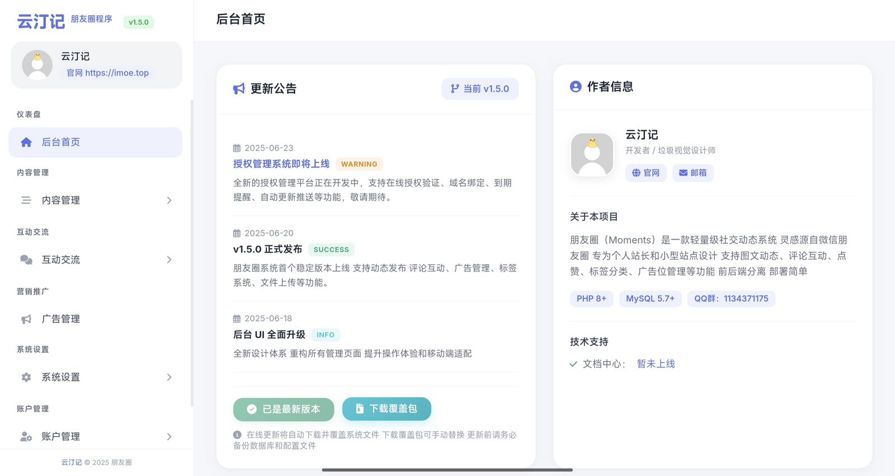
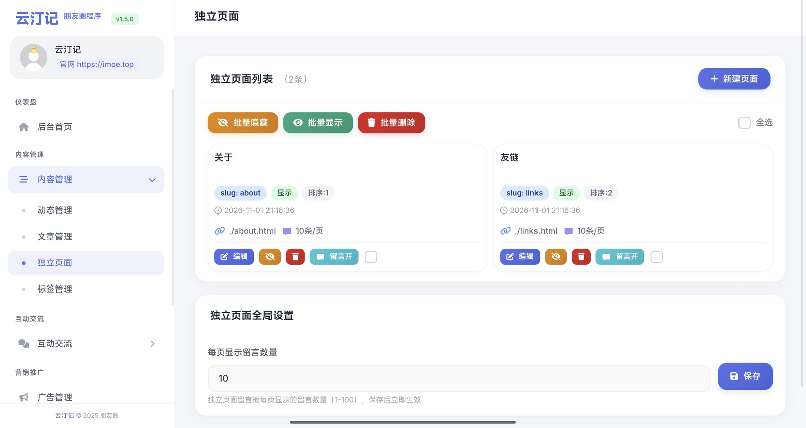
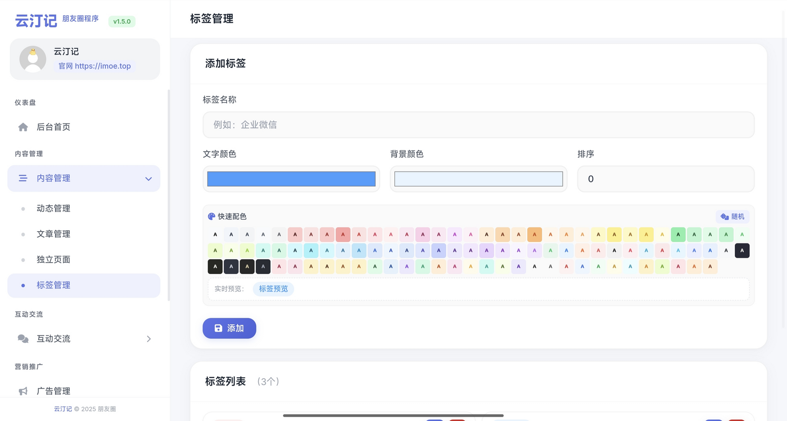
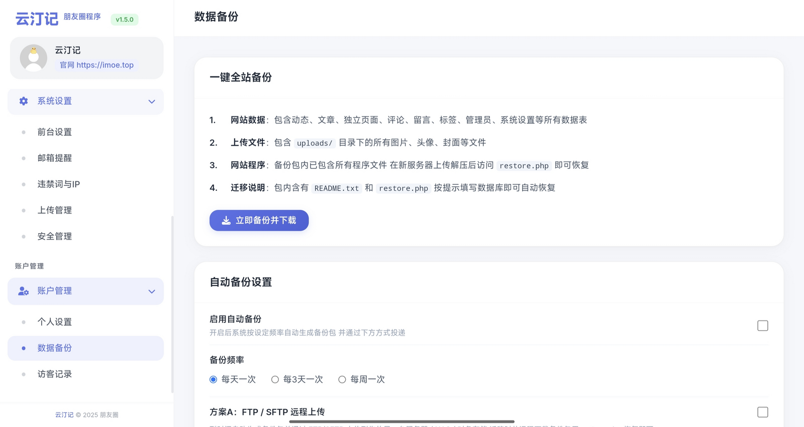
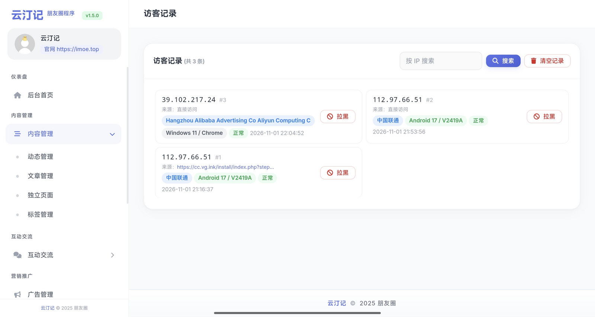

## 云汀记 · 朋友圈程序

> 一款原生 PHP + MySQL精致朋友圈风格个人站点 无框架 无 Composer 无构建步骤 上传即用


动态 文章 单页混排成一条时间流 带评论 点赞 标签 广告位和一套完整后台 移动端优先 PC前台适应差

---

### ✨ 特性

**内容**

| | |
| --- | --- |
| 📝 **动态流** | 文字 / 图片 / 视频 / 音乐 支持置顶 文章与广告按时间混排 |
| 📄 **文章** | Markdown 编写 支持一套排版短代码（提示块、标签页、卡片、B 站嵌入等） |
| 📑 **独立页面** | 关于、友链、留言板等 可自定模板与排序 |
| 🏷️ **标签系统** | 自定义颜色 按标签筛选内容 |
| 📡 **RSS** | 自动输出 支持 `/feed` 与 `/rss.xml` |

**交互**

| | |
| --- | --- |
| ❤️ **点赞** | 按 IP 去重 游客免登录 |
| 💬 **评论** | 多级回复、可开启审核、表情包解析、违禁词过滤 |
| 🔄 **加载方式** | 手动「加载更多」或滚动自动加载 |
| ⚡ **PJAX** | 无刷新跳转 保留滚动位置 |
| 📱 **响应式** | 移动端优先 PC 端自适应 |

**后台**

| | |
| --- | --- |
| 🗂️ **内容管理** | 动态、文章、页面、评论、标签、广告位 |
| 📤 **上传管理** | 图片与视频统一归档 支持清理 |
| 👣 **访客日志** | 记录访问 IP、UA、地区 支持封禁 |
| ✉️ **邮件通知** | SMTP 发送新评论提醒 可自定义模板 |
| 💾 **数据备份** | 手动 / 定时备份、在线恢复、备份发送到邮箱 |
| 🎨 **站点设置** | 头像、昵称、签名、封面、分页数、字号、配色等 40 余项 |

---

### 🖼 界面预览

<p align="center">
  
  
  
</p>
<p align="center">
  
  
</p>

---

### 🚀 快速开始

#### 环境要求

| 项目 | 要求 |
| --- | --- |
| PHP | 7.4 及以上（8.x 可用） |
| PHP 扩展 | `mysqli` `mbstring` `fileinfo` `curl` `zip` `json` |
| 数据库 | MySQL 5.7+ / MariaDB 10.3+ 字符集 `utf8mb4` |
| Web 服务器 | Apache（`mod_rewrite` + `AllowOverride All`）或 Nginx |
| 目录权限 | 站点根目录可写 `uploads/`、`cache/` 可写 |

#### 安装

```bash
git clone https://github.com/PearBlossomPoetry/yuntingji-moments.git
```

1. 上传全部文件到网站根目录 确保根目录可写
2. 访问域名 未安装时会显示引导页 点 **前往安装**
3. 依次填写数据库信息 → 选择「清空旧数据 / 保留数据」并设置管理员账号 → 完成
4. 删除 `install/` 目录（`install.lock` 已能拦截重复安装 删除更稳妥）
5. 后台入口：`https://你的域名/admin/`

---

### 📁 目录结构

```
├── index.php          首页信息流
├── article.php        文章详情（伪静态 /slug.html）
├── page.php           独立页面
├── rss.php            RSS 输出
├── config.php         全局配置、数据库连接、内容解析、评论渲染
├── not_installed.php  未安装引导页
├── upgrade.php        数据结构升级（需登录）
├── unban_me.php       IP 解封工具
├── admin/             后台（内容、评论、标签、广告、设置、备份）
├── api/               前台接口（评论、点赞、加载更多、上传、音乐解析）
├── assets/            Parsedown、样式、脚本、表情包、背景图、字体
├── install/           安装向导
├── uploads/           用户上传文件
├── cache/             临时缓存
└── .htaccess          Apache 伪静态与安全规则
```

---

### 🧩 短代码

正文支持 Markdown 另有一组排版短代码：

| 短代码 | 说明 |
| --- | --- |
| `[hint type="info" title="标题"]内容[/hint]` | 提示块 type 可填 `info` / `warn` / `danger` |
| `[tabs selected="0"][tab name="一"]内容[/tab][/tabs]` | 标签页 |
| `[graybox]内容[/graybox]` | 灰色区块 |
| `[tag color="#5b73e8"]文字[/tag]` | 彩色标签 |
| `[btn url="链接"]按钮文字[/btn]` | 按钮 |
| `[link][图标][标题][描述][链接][/link]` | 链接卡片 |
| `[file url="链接" name="文件名"]说明[/file]` | 文件下载卡片 |
| `[github owner/repo/]` | GitHub 仓库卡片 |
| `[bilibili]BV号或视频链接[/bilibili]` | 嵌入 B 站视频 |
| `[image id=1]` `[video id=1]` `[music id=1]` | 引用已上传的媒体 |
| `[html]任意 HTML[/html]` | 直接嵌入 HTML |
| `:kawa-1:` `:heo-xx:` | 表情包 |

---

### 🔗 伪静态

Apache 随包提供 `.htaccess` 无需额外配置 Nginx 参考：

```nginx
rewrite ^/([a-zA-Z0-9_-]+)\.html$ /article.php?slug=$1 last;
location / { try_files $uri $uri/ /index.php?$query_string; }

location ~* \.(env|ini|log|sql|bak|zip|gz|rar)$ { deny all; }
location ~ /\. { deny all; }
```

---

### ⚙️ 服务器建议

```ini
upload_max_filesize = 100M
post_max_size       = 100M
max_execution_time  = 300
memory_limit        = 256M
```

程序内限制：图片 20 MB 视频 100 MB（`api/upload.php` 可改）

上传仍失败的排查顺序：`uploads/` 权限 → `fileinfo` 扩展 → PHP 上传上限 → 主机是否拦截 `multipart`

---

### ❓ 常见问题

<details>
<summary><b>点「前往安装」报 403</b></summary>

本版已移除 `.htaccess` 里对 `install/` 的整目录拦截 若仍 403 检查主机安全插件是否拦截该目录 或 Apache 未开启 `AllowOverride`
</details>

<details>
<summary><b>提示数据库连接失败</b></summary>

检查根目录 `db.config.php` 中的地址、账号、密码、库名 并确认服务器装了 `mysqli` 扩展
</details>

<details>
<summary><b>首页正常但文章链接 404</b></summary>

伪静态没生效 Apache 检查 `mod_rewrite` 与 `AllowOverride`Nginx 加上文规则。
</details>

<details>
<summary><b>忘记后台密码</b></summary>

```bash
php -r "echo password_hash('新密码', PASSWORD_DEFAULT);"
```

然后执行：`UPDATE admin SET password = '哈希值' WHERE username = '账号';`
</details>

<details>
<summary><b>换域名后页面里还是旧域名</b></summary>

站点域名写在多个文件的链接与 `placeholder` 里 全局搜索替换即可：`grep -rn "旧域名" .`
</details>

---

### 🛡 安全建议

- 装完删除 `install/` 目录
- 修改 `unban_me.php` 中的访问密钥
- `admin/` 目录可改名；`.htaccess` 已拦截 `.sql`、`.zip` 等敏感文件 Nginx 需按上文补规则
- 定期备份数据库与 `uploads/`

---

### 📄 许可

[MIT](LICENSE) · 可商用、可修改、可再分发 保留版权声明即可

---

### ⭐ 其他

- 版本：`1.5.0`
- 技术栈：PHP + MySQL 原生实现 无第三方运行时依赖
- 反馈：此版已停止维护 感兴趣可加QQ群聊：1134371175
